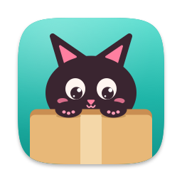

<p align="center">
  
</p>

<h1 align="center">Kitty Box</h1>

<p align="center">
  纯原生的文件工具箱：打包 · 解压 · 图片转换 · 去水印
</p>

<p align="center">
  
  
  
  
</p>

把常用的文件处理放进一个原生窗口：文件拖到程序坞图标或窗口上，选一个工具就处理好，结果另存在原文件旁边，不碰原文件。macOS 版用 Swift 6 + SwiftUI / AppKit 写成，除了随包的 7-Zip 和画笔擦除用的 LaMa 模型，只用系统自带的能力，全部在本机完成、不联网。

> 个人项目，**第一版在测试中，暂时没有可下载的版本**，想试可以按下面「从源码构建」自己编。只支持 Apple 芯片、macOS 15 及以上。以后会再写一套 Windows 版。

## 分支

`main` 只放这份介绍，代码按平台分在各自的分支里：

| 分支 | 内容 | 发布 |
|---|---|---|
| [`macos`](https://github.com/YyAdnBug/kitty-box/tree/macos) | macOS 版（Swift 6 + SwiftUI / AppKit） | tag `macos-v*`，最新一版标 latest |
| `windows` | Windows 版，以后再建 | — |

## 功能

### 📦 打包

- 打成 zip 或 7z，可以设密码；7z 设了密码连文件名也一起加密
- **忽略清单**：默认去掉 `.DS_Store`、`._*`、`__MACOSX`、`Thumbs.db` 这类系统杂文件；`.git`、`node_modules` 等开发目录一键勾上；也能自己加规则（`*.log`、`草稿/`）。打包前会显示忽略了哪些
- 照顾 Windows：列出哪些文件名 Windows 不认；带密码的 zip 可以选成 Windows 自带解压也能打开的方式

### 🗂️ 解压

- zip、7z、RAR、tar、iso 等，带密码的 zip / 7z / RAR 都能解，密码就地问
- **Windows 打的 zip 中文文件名不乱码**：自己判断文件名是 GBK 还是 UTF-8
- 解到压缩包旁边：包里只有一样东西时直接放出来，不然放进同名文件夹；`__MACOSX`、`._*` 不解出来；从网上下载的包，解出来的东西也带「从网上下载」的标记

### 🖼️ 图片转换

- HEIC、WebP、AVIF、JXL、RAW、PSD 等都能读，转成 JPEG、PNG、HEIC、AVIF、TIFF、GIF、BMP、ICO、ICNS、PDF
- 批量转换，可以调质量；照片里的拍摄信息原样保留，竖着拍的自动转正

### 🧽 去水印

- **Gemini 角标**：用反向 alpha 混合把 Gemini 生成图右下角的星标还原掉，不靠 AI 猜；认不出的一键改用画笔擦除
- **画笔擦除**：涂哪擦哪，本机的 LaMa 模型补全，原图分辨率不变；擦完能接着涂、能撤销
- **视频台标**：在第一帧上框出台标位置（可以框几处），逐帧补掉，编码跟原视频走

## 从源码构建

代码在 `macos` 分支，需要 Xcode 27 和 Apple 芯片的 Mac。

```bash
git clone -b macos https://github.com/YyAdnBug/kitty-box.git
cd kitty-box
macos/fetch-vendor.sh   # 按 SHA256 下载随包的 7zz 和 LaMa 模型（约 210 MB）
xcodebuild -project macos/KittyBox.xcodeproj -scheme KittyBox build
```

- **签名**：`macos/Config/Base.xcconfig` 里的 `DEVELOPMENT_TEAM` 改成你自己的 Team ID。
- **单元测试**：`xcodebuild -project macos/KittyBox.xcodeproj -scheme KittyBox test`
- **打 DMG**：`macos/build-dmg.sh`，产物在 `macos/build/`。
- 开发约定见 `macos` 分支的 [AGENTS.md](https://github.com/YyAdnBug/kitty-box/blob/macos/AGENTS.md)，方案见 [macos/PLAN.md](https://github.com/YyAdnBug/kitty-box/blob/macos/macos/PLAN.md)。

## 致谢

- 打包和解压 7z、RAR 用的是 [7-Zip](https://github.com/ip7z/7zip)（LGPL 2.1，随包分发）
- Gemini 去水印的算法和 α 图来自 [GargantuaX/gemini-watermark-remover](https://github.com/GargantuaX/gemini-watermark-remover)，也参考了 [allenk/GeminiWatermarkTool](https://github.com/allenk/GeminiWatermarkTool)（都是 MIT）
- 画笔擦除用的是 [LaMa](https://github.com/advimman/lama)，Core ML 版来自 [mlboydaisuke/LaMa-CoreML](https://huggingface.co/mlboydaisuke/LaMa-CoreML)（Apache-2.0）
- 随包组件的许可证和出处见 `macos` 分支的 [NOTICE.md](https://github.com/YyAdnBug/kitty-box/blob/macos/NOTICE.md)

## 许可证

[MIT](LICENSE)
